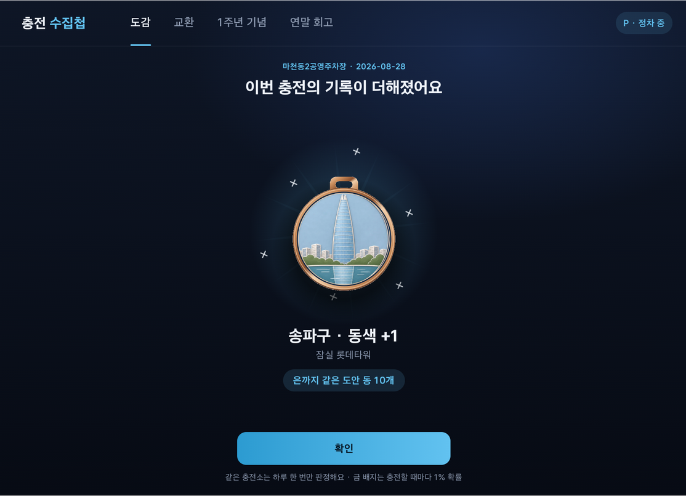
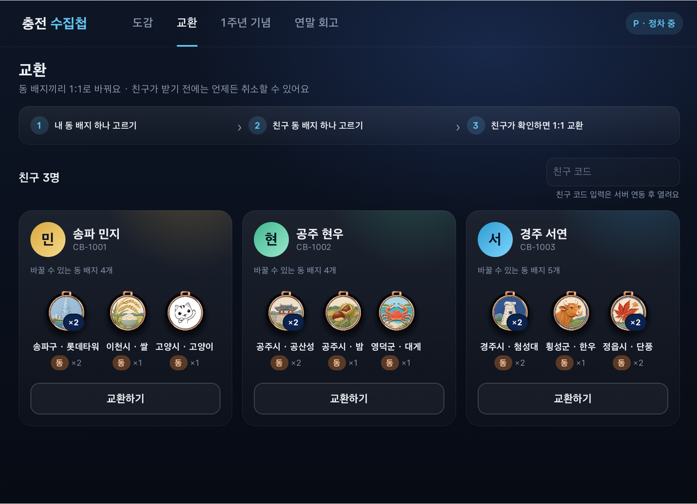
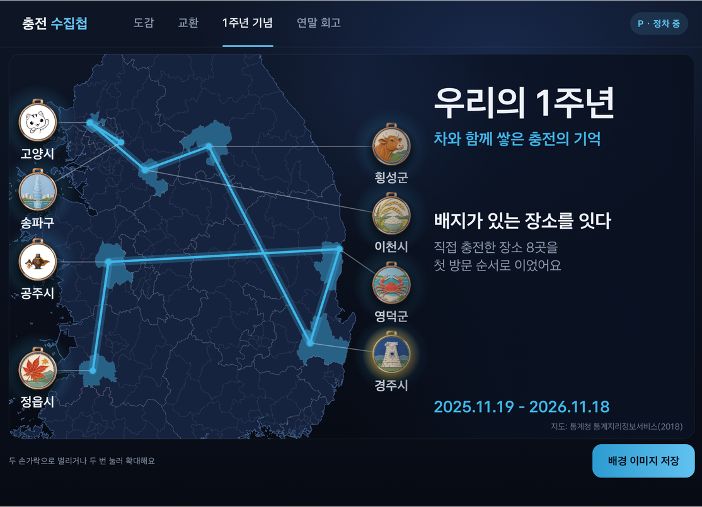
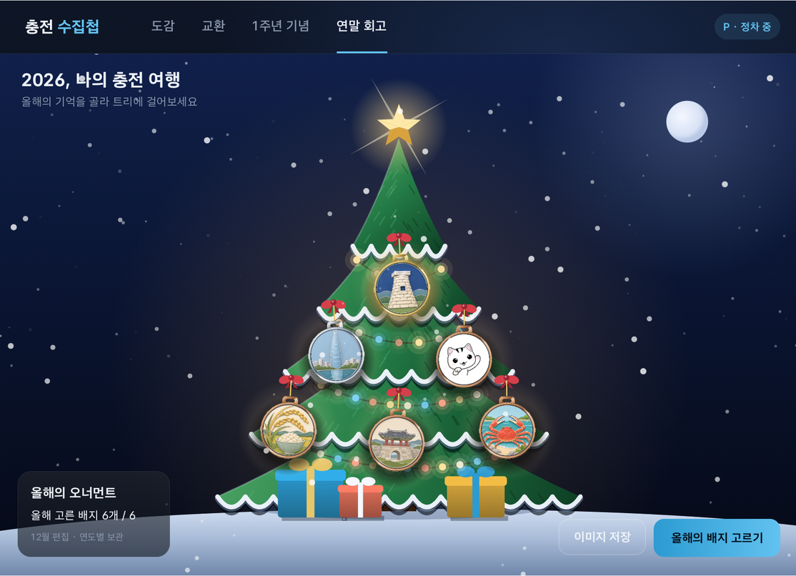

# 충전 수집첩

전기차를 충전한 시·군·구의 배지를 모으는 Pleos Connect 차량용 앱입니다.
차가 직접 측정한 충전율과 내비게이션 위치로 "이 충전소에서 충전했다"를 확인하고, 그 지역의 배지를 줍니다.

| 도감 | 배지 획득 | 충전 중 |
|---|---|---|
|  |  |  |

| 교환 | 교환 제안 | 1주년 기념 지도 | 연말 트리 |
|---|---|---|---|
|  |  |  |  |

## 무엇을 하나요

- **충전하면 배지**: 공공 충전소 반경 50m 안에서 충전율이 3%p 이상 오르면 그 시·군·구 배지를 받습니다. 같은 충전소는 하루에 한 번만 판정합니다. 지금은 배지 도안이 있는 8곳(고양, 이천, 송파, 공주, 경주, 영덕, 횡성, 정읍)에서만 배지가 나옵니다.
- **도감과 합성**: 도안은 지역마다 하나, 공주만 셋(공산성·밤·고마곰)이고 동·은·금으로 나뉩니다. 금은 충전할 때 1% 확률로 나오고, 은은 같은 도안 동 10개를 합성해 만듭니다.
- **시동을 끈 채 충전해도**: 시동을 끌 때의 충전율과 위치를 저장해 두고, 다음 시동 때 판정합니다.
- **교환**: 친구와 동 배지를 1:1로 바꿉니다. 상대가 받기 전에는 언제든 취소할 수 있고, 7일 뒤 자동으로 만료됩니다. 지금은 서버 없이 가짜 친구 3명과 동작합니다.
- **연말 회고**: 12월에 올해의 배지 6개를 트리에 걸고 배경 이미지로 저장합니다.
- **1주년 기념**: 앱을 설치한 날부터 1년 동안 직접 충전한 곳을 시·군·구 지도 위에 첫 방문 순서로 잇고, 가로 배경 이미지로 저장합니다. 지도는 손가락으로 확대·이동할 수 있습니다.

## 차량 연동

| 쓰는 것 | 용도 |
|---|---|
| Pleos Vehicle SDK 2.3.2 | 충전율(SOC), 충전 포트 열림, 충전 스위치, 기어 |
| NaviHelper 3.0.5 | 판정에 쓰는 현재 위치 |
| FusedLocation 1.1.3 | 보조 위치 |
| CarUxRestrictionsManager | 주행 중에는 화면을 닫고 충전 확인만 계속 |
| BOOT_COMPLETED + 포그라운드 서비스 | 시동을 켜면 충전 감지 자동 시작 |

## 실행하기

필요한 것: Android SDK, JDK 17, Pleos 에뮬레이터(API 34).

```bash
./gradlew :core:test :app:assembleRelease
adb -e install -r app/build/outputs/apk/release/app-release.apk
```

릴리스 빌드는 시연 편의를 위해 디버그 키로 서명합니다. 미리 빌드한 APK: [release/charge-collector-v0.1.apk](release/charge-collector-v0.1.apk)

- **충전 시험**: `adb -e forward tcp:8088 tcp:8088` 뒤 에뮬레이터 차량 콘솔(`http://127.0.0.1:8088`)에서 기어를 P로 두고 충전 포트를 연 다음, 충전율을 1%p씩 올립니다. 에뮬레이터 위치가 공공 충전소 50m 안에 있어야 합니다.
- **시연용 샘플 데이터**: 아래 명령은 그 날짜를 "오늘"로 두고 1년치 충전 기록을 넣습니다. 도감, 1주년 지도, 연말 트리를 바로 볼 수 있습니다. `--es sample off`는 실제 날짜로 되돌립니다.

  ```bash
  adb -e shell am start --user 10 -n kr.chargebadge/.MainActivity --es sample 2026-12-03
  ```

## 구조

```
core/   순수 Kotlin 엔진과 테스트
        ChargeDetector(충전 판정) · BadgeEngine(배지·합성·교환) · StationIndex(충전소 50m 매칭)
        Calendar(연말·1주년 규칙) · KoreaMap(지도 자산) · Sample(시연 데이터)
app/    Jetpack Compose 화면, 충전 감지 서비스(ChargeService), 그리기(Images.kt), 움직임(Motion.kt)
tools/  앱 자산을 만드는 스크립트
docs/   스크린샷
```

엔진 테스트는 `./gradlew :core:test`로 돌립니다(30개).

## 데이터와 출처

- **충전소**: 한국환경공단 전기자동차 충전소 정보(공공데이터포털 15076352).
  - `tools/fetch_and_map.py`로 받아 시·군·구(일반구 포함)에 매핑합니다.
  - `tools/pack_sizes.py`로 주소 없는 CSV로 줄여 `app/src/main/assets/stations_min.csv`에 넣었습니다(충전소 100,627곳, 지역 256개).
- **시·군·구 경계**: 통계청 통계지리정보서비스(SGIS) 2018, 공공누리 제1유형([southkorea/southkorea-maps](https://github.com/southkorea/southkorea-maps) 경유).
  - `tools/build_korea_map.py`로 점 257,545개를 38,654개로 줄였습니다.
  - 2018년 이후 새로 생긴 11개 구는 옛 경계로 대신 칠합니다.
- **배지 그림**: 팀 제작. 피그마에서 내보낸 메달 판을 `tools/cut_medals.py`로 지역·도안·등급별 파일 30개로 잘랐습니다.

## 알려진 한계

- 배지 도안이 있는 지역이 아직 8곳이라, 나머지 지역에서는 충전해도 배지가 나오지 않습니다.
- 친구는 서버 연동 전이라 가짜 친구 3명입니다.
- 공공데이터 충전소 중 일부(약 1.8%)는 좌표가 부정확해 50m 판정에서 빠질 수 있습니다.
- 경계 데이터가 2018년 기준입니다.
