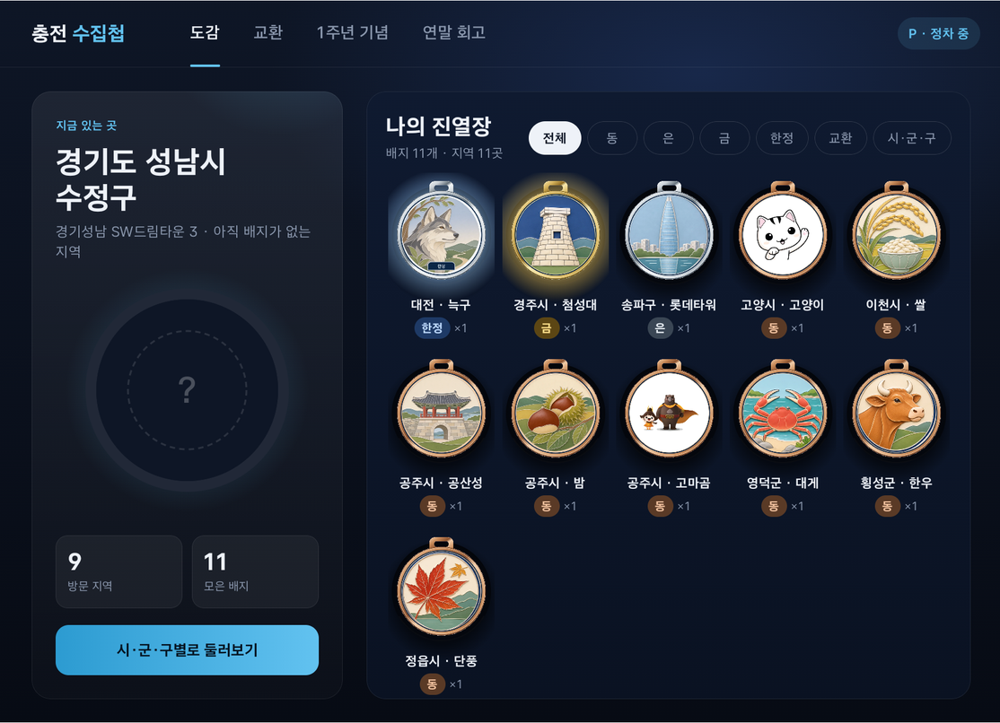
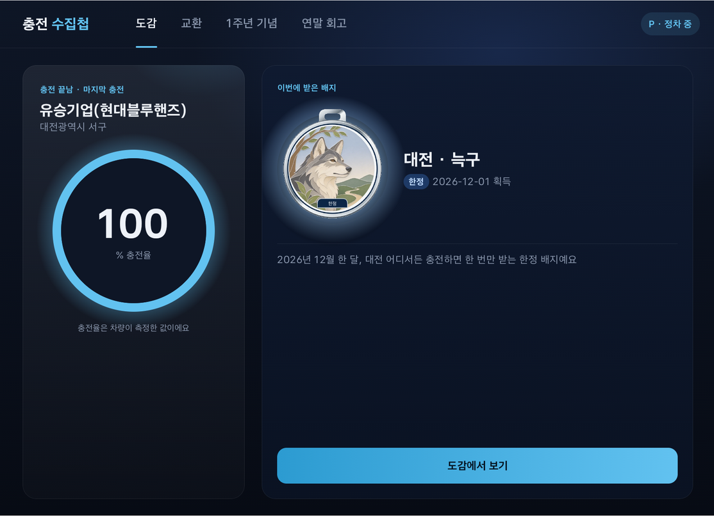
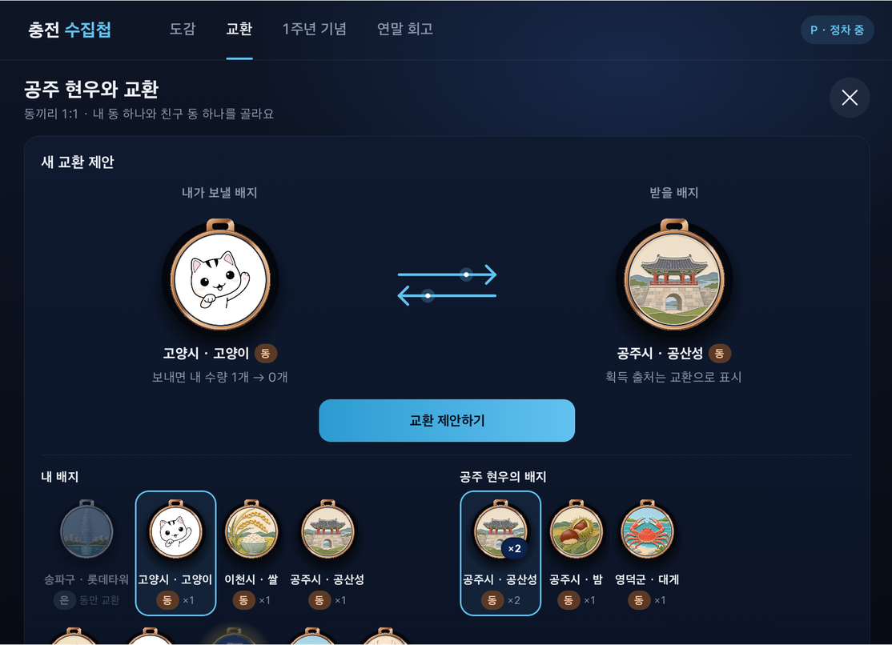

# 차지 컬렉션 (Charge Collection)

팀: **도미닉**

> **디자인 변경 검토 자료**: [화면별 전후 캡처·검증·머지 확인목록](docs/design-review/README.md). 기존 화면 구성을 유지한 디자인 변경이며, 아래 스크린샷과 제출 APK는 변경 후 화면입니다.

전기차를 충전한 시·군·구의 배지를 모으는 Pleos Connect 차량용 앱입니다.
차가 직접 측정한 충전율과 내비게이션 위치로 "이 충전소에서 충전했다"를 확인하고, 그 지역의 배지를 줍니다.

| 도감 | 배지 획득 | 충전 중 |
|---|---|---|
|  |  |  |

| 교환 | 교환 제안 | 1주년 기념 지도 | 연말 트리 |
|---|---|---|---|
|  |  |  |  |

- **APK**: [apk/도미닉_차지컬렉션_release.apk](apk/도미닉_차지컬렉션_release.apk)
- **시연 영상**: [docs/demo/demo.mp4](docs/demo/demo.mp4) (112.733초 · 1920×1080 · 사용자 제공 새 시연 영상 원본). 도감, 충전으로 배지 받기, 교환, 1주년 지도, 연말 트리, 주행 중 화면 제한 순서입니다.

## 무엇을 하나요

- **충전하면 배지**: 공공 충전소 반경 50m 안에서 충전율이 3%p 이상 오르면 그 시·군·구 배지를 받습니다. 같은 충전소는 하루에 한 번만 판정합니다. 지금은 배지 도안이 있는 8곳(고양, 이천, 송파, 공주, 경주, 영덕, 횡성, 정읍)에서만 배지가 나옵니다.
- **한정 배지 늑구**: 2026년 12월 한 달 동안 대전(구 5곳 어디든)에서 충전하면 한정 배지 '늑구'를 한 번 받습니다. 한정은 동·은·금과 따로 있는 등급이라 교환·합성에는 쓰지 않습니다.
- **도감과 합성**: 도안은 지역마다 하나, 공주만 셋(공산성·밤·고마곰)이고 동·은·금으로 나뉩니다. 금은 충전할 때 1% 확률로 나오고, 은은 같은 도안 동 10개를 합성해 만듭니다.
- **시동을 끈 채 충전해도**: 시동을 끌 때의 충전율과 위치를 저장해 두고, 다음 시동 때 판정합니다.
- **교환**: 친구와 동 배지를 1:1로 바꿉니다. 상대가 받기 전에는 언제든 취소할 수 있고, 7일 뒤 자동으로 만료됩니다. 지금은 서버 없이 가짜 친구 3명과 동작합니다.
- **연말 회고**: 12월에 올해의 배지 6개를 트리에 겁니다. 장식을 누르면 크게 보이고, 그 배지를 언제 어디서 어떻게 얻었는지 이야기를 보거나 다른 배지로 바꿀 수 있습니다.
- **1주년 기념**: 앱을 설치한 날부터 1년 동안 직접 충전한 곳을 시·군·구 지도 위에 첫 방문 순서로 잇습니다. 지도는 손가락으로 확대·이동할 수 있고, 배지를 누르면 그 충전소로 확대해 위치와 이름, 배지 정보를 보여 줍니다.

## 차량 연동

| 쓰는 것 | 용도 |
|---|---|
| Pleos Vehicle SDK 2.3.2 | 충전율(SOC), 충전 포트 열림, 충전 스위치, 기어 |
| NaviHelper 3.0.5 | 판정에 쓰는 현재 위치 |
| FusedLocation 1.1.3 | 보조 위치 |
| CarUxRestrictionsManager | 주행 중에는 화면을 닫고 충전 확인만 계속 |
| BOOT_COMPLETED + 포그라운드 서비스 | 시동을 켜면 충전 감지 자동 시작 |

## 테스트 환경

Apple Silicon Mac의 다음 환경에서 확인했습니다. 화면 규격은 영상 파일 크기와 구분합니다.

| 항목 | 확인한 값 |
|---|---|
| Pleos Connect 시스템 버전 | **2.1.0** (`RELEASE.release_connect_v2.1.0`, 시스템 이미지 `build.prop`) |
| Android 시스템 이미지 | Android Automotive 14 / API 34 / arm64-v8a, 42dot 제공, 패키지 revision 1 |
| Android Emulator | **36.5.11.0**, build 15261927 |
| AVD / 기기 프로필 | `N07_Pleos_2_1` / `automotive_1024p_landscape` |
| 실제 실행 화면 | **2560×1440 px**, 가로, **160dpi** (`hardware-qemu.ini`) |
| 제출 영상 파일 | **1920×1080 px**, 30fps, 112.733초 (파일 메타데이터 기준) |

설치된 이미지의 `build.prop`·`source.properties`, AVD의 `config.ini`·`hardware-qemu.ini`, 에뮬레이터 버전 로그, 영상의 `ffprobe` 결과로 확인했습니다. 1920×1080은 제출 영상의 인코딩 규격이며 에뮬레이터 실행 화면 규격은 2560×1440입니다. 파일별 무결성·이전 영상 보존 근거는 [제출 자료 확인 기록](docs/submission/verification.json)에 있습니다.

- 앱은 에뮬레이터의 운전자 사용자(user 10)에서 실행합니다. 아래 `am start` 명령에 `--user 10`이 붙는 이유입니다.
- minSdk 34, targetSdk 35, JDK 17.
- 충전 판정을 시험하려면 차량 콘솔 포트 포워딩과, 공공 충전소 50m 안의 차 위치가 필요합니다. 둘 다 아래에 적었습니다.

## 실행하기

필요한 것: Android SDK, JDK 17, Pleos 에뮬레이터(API 34).

```bash
./gradlew :core:test :app:assembleRelease
adb -e install -r app/build/outputs/apk/release/app-release.apk
```

릴리스 빌드는 시연 편의를 위해 디버그 키로 서명합니다. 미리 빌드한 APK는 [apk/도미닉_차지컬렉션_release.apk](apk/도미닉_차지컬렉션_release.apk)이고, `adb -e install -r apk/도미닉_차지컬렉션_release.apk`로 바로 설치할 수 있습니다.

- **충전 시험**: `adb -e forward tcp:8088 tcp:8088` 뒤 에뮬레이터 차량 콘솔(`http://127.0.0.1:8088`)에서 기어를 P로 두고 충전 포트를 연 다음, 충전율을 1%p씩 올립니다. 에뮬레이터 위치가 공공 충전소 50m 안에 있어야 합니다.
- **시연용 샘플 데이터**: 아래 명령은 그 날짜를 "오늘"로 두고 1년치 충전 기록을 넣습니다(12월이면 늑구 포함). 도감, 1주년 지도, 연말 트리를 바로 볼 수 있습니다. `--es sample off`는 실제 날짜로 되돌립니다.

  ```bash
  adb -e shell am start --user 10 -n kr.chargebadge/.MainActivity --es sample 2026-12-03
  ```

- **시연용 현위치**: 에뮬레이터의 내비 위치는 한곳에 고정되어 있어, 아래 명령으로 앱이 쓰는 차 위치를 옮깁니다(예: 공주 산성시장 공영주차타워). 앱을 다시 켜도 유지되고, `--es here off`는 내비 위치로 되돌립니다.

  ```bash
  adb -e shell am start --user 10 -n kr.chargebadge/.MainActivity --es here 36.45881,127.12272
  ```

## 구조

```
core/   순수 Kotlin 엔진과 테스트
        ChargeDetector(충전 판정) · BadgeEngine(배지·합성·교환) · StationIndex(충전소 50m 매칭)
        Calendar(연말·1주년 규칙) · KoreaMap(지도 자산) · Sample(시연 데이터)
app/    Jetpack Compose 화면, 충전 감지 서비스(ChargeService), 그리기(Images.kt), 움직임(Motion.kt)
tools/  앱 자산을 만드는 스크립트
docs/   스크린샷, 디자인 검토 자료(design-review), 검수·설계 검토 문서(review)
```

엔진 테스트는 `./gradlew :core:test`로 돌립니다(32개).

## 데이터와 출처

- **충전소**: 한국환경공단 전기자동차 충전소 정보(공공데이터포털 15076352).
  - `tools/fetch_and_map.py`로 받아 시·군·구(일반구 포함)에 매핑합니다.
  - `tools/pack_sizes.py`로 주소 없는 CSV로 줄여 `app/src/main/assets/stations_min.csv`에 넣었습니다(충전소 100,627곳, 지역 256개).
- **시·군·구 경계**: 통계청 통계지리정보서비스(SGIS) 2018, 공공누리 제1유형([southkorea/southkorea-maps](https://github.com/southkorea/southkorea-maps) 경유).
  - `tools/build_korea_map.py`로 점 257,545개를 38,654개로 줄였습니다.
  - 2018년 이후 새로 생긴 11개 구는 옛 경계로 대신 칠합니다.
- **배지 그림**: 고양고양이와 고마곰·공주는 지자체 공식 원화를 이용했고, 바깥 메달 프레임과 화면은 팀이 구성했습니다. 공식 원화까지 모두 팀 제작이라는 뜻은 아닙니다. [캐릭터별 공식 출처·원화 보존 기록·이용조건](docs/submission/ASSET_ATTRIBUTION.md)을 함께 확인해 주세요.
  - 고양: [고양시 일러스트](https://www.goyang.go.kr/www/user/bbs/BD_selectBbsList.do?q_bbsCode=1054)의 ‘하이인사’ 원화.
  - 공주: [공주시 기본형](https://www.gongju.go.kr/brand/sub02_03.do)의 고마곰과 공주 원화. 공식 Adobe Illustrator 원본의 캐릭터 한 쌍을 사용했습니다.
  - 두 원화는 **공공누리 제3유형(출처 표시·변경금지)** 조건을 따릅니다. 별도 이용허락이나 지자체의 후원·승인은 받지 않았습니다. 고양시의 디자인 응용 협의 조건과 현재 프레임 결합의 허용 범위는 별도 확인이 남아 있습니다.
  - 피그마에서 내보낸 메달 판을 `tools/cut_medals.py`로 지역·도안·등급별 파일 30개로 나누고 WEBP로 변환했습니다. 늑구 한정 메달은 같은 스크립트의 한 장 모드로 넣었습니다. 공식 원본과 APK 안 파일의 바이트가 같다는 의미는 아닙니다.

## 사용한 라이브러리와 라이선스

- Pleos Vehicle SDK 2.3.2, NaviHelper 3.0.5, FusedLocation 1.1.3: Pleos Playground에서 받은 SDK이며 제공처의 이용 조건을 따릅니다.
- Jetpack Compose(BOM 2024.10.01), Material 3, Activity Compose 1.9.3, Kotlin 표준 라이브러리: Apache License 2.0.
- 글꼴: 차량에 들어 있는 Pleos 글꼴(`/product/fonts`)을 읽어 쓰며, 앱에는 글꼴 파일을 넣지 않았습니다.
- 충전소·경계 데이터의 출처는 위 ‘데이터와 출처’에, 공식 캐릭터별 조건과 배포 시 주의사항은 [캐릭터 출처·이용조건](docs/submission/ASSET_ATTRIBUTION.md)에 있습니다. APK·영상·이미지를 따로 전달할 때도 이 출처 문서를 함께 제공해야 합니다.

## 알려진 한계

- 배지 도안이 있는 지역이 아직 8곳이라, 나머지 지역에서는 충전해도 배지가 나오지 않습니다.
- 친구는 서버 연동 전이라 가짜 친구 3명입니다.
- 공공데이터 충전소 중 일부(약 1.8%)는 좌표가 부정확해 50m 판정에서 빠질 수 있습니다.
- 경계 데이터가 2018년 기준입니다.

- 공식 캐릭터는 원화 바깥에 별도 프레임을 배치했습니다. 공공누리는 원화의 단순 탑재를 허용한다고 설명하지만, 고양시의 응용 협의와 공주시의 개별 사용승인 절차가 이 앱에 어떻게 적용되는지는 기관 확인을 받지 않았습니다. 미수집 상태의 흑백·반투명 표시는 유지합니다. APK·기념 이미지 단독 공유에도 출처 문서가 필요합니다. [프레임 조건 검토](docs/submission/ASSET_ATTRIBUTION.md#프레임-결합에-대한-추가-확인)를 참고해 주세요.
