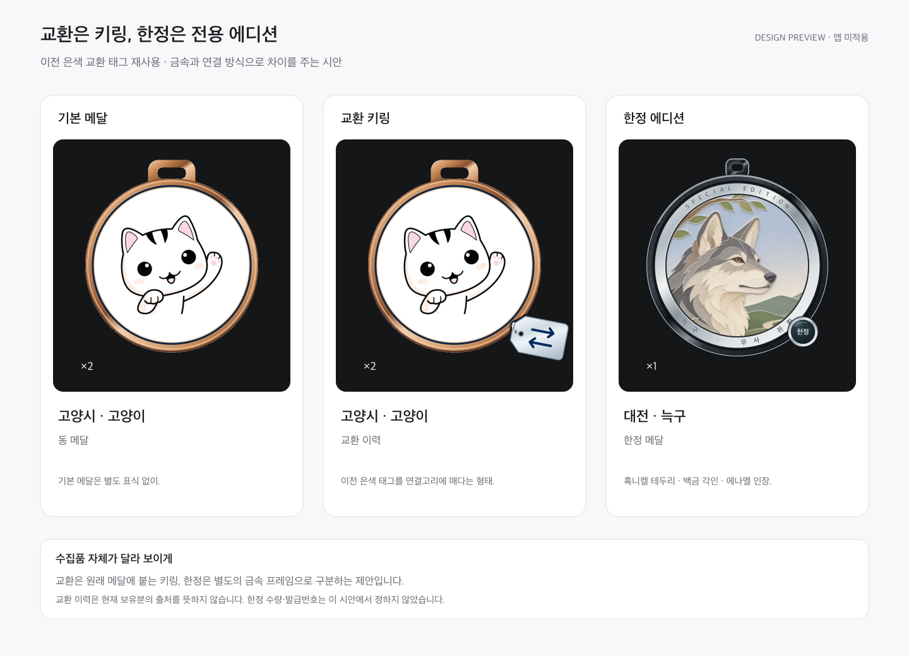

# 라벨 재검토 시안 — 교환 키링 / 한정 에디션

**검토용 시안이며 앱 기능에는 적용하지 않았습니다.** 기각된 하단 사각 명패안은 이 브랜치에 포함하지 않습니다.

## 교환 키링

11/12 직접·교환 획득 시안 v11의 은색 금속 태그 SVG를 재사용합니다. 화살표와 태그 모양은 유지하고, 연결 고리를 더해 원래 메달 오른쪽 아래에 매다는 형태입니다. 고양시 마스코트 원본 그림은 바꾸지 않았습니다.

표시 의미의 1차 제안은 **교환으로 받은 이력**입니다. 현재 보유분의 출처를 뜻하는 것으로 확정하지 않았습니다. 작은 도감 크기에서는 태그/고리의 읽힘과 주변 메달 간 간격을 확인한 뒤 크기를 정해야 합니다.

## 한정 에디션

단순 글자 라벨 대신 흑니켈 외곽·백금색 각인 링·작은 에나멜 인장을 가진 전용 프레임을 제안합니다. 늑구 원본 그림은 원형 창에 배치하고, 기존 원본의 사각 명패는 창 바깥으로 빠지도록 구도를 잡았습니다. 원본 이미지 파일 자체는 수정하지 않았습니다.

한정 수량·발급번호·추가 보상 정책을 정한 시안은 아닙니다. 재질·프레임과 시각 차별성만 검토합니다. 앱에서 쓰는 현행 한정 메달 이미지는 그대로입니다.

## 개발 변경과 분리

[교환 이력과 현재 보유 출처의 데이터 검토 PR #3](https://github.com/charge-collector-team/charge-collector/pull/3)은 별도 브랜치에 있습니다. 이 디자인 브랜치에는 재고·출처·교환 엔진 변경을 넣지 않습니다.

## 확인할 것

- [ ] 교환 태그가 기존 키링처럼 보이는지
- [ ] 작은 도감에서도 태그와 수량/선택선이 겹치지 않는지
- [ ] 한정 전용 프레임이 기본 동·은·금과 충분히 다른지
- [ ] 기획·디자인 확인 후 실제 앱 라벨 적용 범위를 결정

SVG/PNG와 생성 소스는 `labels/`에 있습니다. 보드는 코드로 조립한 디자인 시안이며 실제 앱 스크린샷이 아닙니다.
