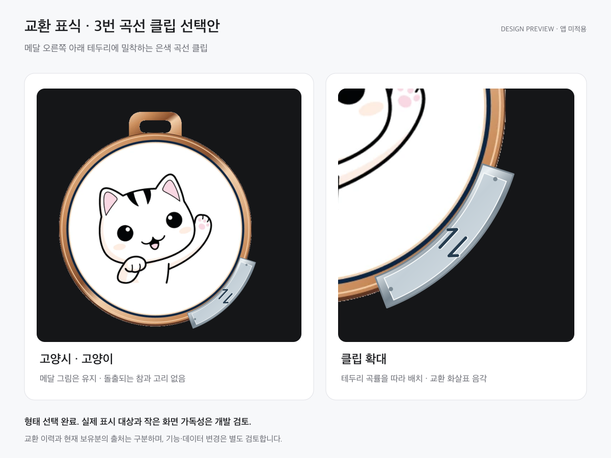

# 교환 표식 — 3번 곡선 클립 선택안

2026-11-15 사용자 선택: **3번 곡선 클립**. 오른쪽 테두리를 뚫어 원형 참을 매다는 안은 사용하지 않습니다.

**형태를 선택한 디자인 전달 자료입니다. 앱에는 아직 적용하지 않았습니다.** 실제 앱 화면 캡처와 구분해 주세요.



## 적용할 모양

- 메달 오른쪽 아래의 곡률을 따라 붙는 은색 금속 클립.
- 교환 화살표를 음각으로 표시하고 양 끝에 작은 고정점을 배치.
- 기존 메달 그림·캐릭터·동·은·금 재질은 유지.
- 별도의 연결 고리, 타공, 매달린 원형/타원 참, 사각 태그는 사용하지 않음.
- 클립과 메달을 하나의 단위로 확대·축소하며 수량·선택선과 겹침을 확인.

시안의 메달 외곽 반지름을 137로 볼 때 클립의 외곽/안쪽 반지름은 150/127, 각도는 오른쪽 방향 기준 아래로 18~69도입니다. `labels/build_exchange_clip.py`는 SVG를 생성합니다. PNG는 아래 별도 렌더 명령으로 생성합니다. 이 수치는 시안 비례이며 앱의 최종 픽셀 크기는 아닙니다.

재생성 명령(저장소 루트에서 실행, Python Pillow·rsvg-convert 필요):

```bash
python3 docs/design-review/labels/build_exchange_clip.py
rsvg-convert docs/design-review/labels/exchange-clip-selected.svg -o docs/design-review/labels/exchange-clip-selected.png
```

## 표시 의미와 개발 검토

현재 데이터로 확인 가능한 의미는 **교환으로 받은 이력**입니다. 현재 보유 중인 개별 메달의 출처로 확정한 것이 아닙니다. 동일 도안의 직접 획득분과 교환분을 구분하는 기능은 별도 데이터 설계가 필요합니다.

[교환 이력과 현재 보유 출처의 기술 검토 PR #3](https://github.com/charge-collector-team/charge-collector/pull/3)은 별도 브랜치의 문서입니다. 이 디자인 커밋에는 재고·출처·교환 엔진 변경을 넣지 않았습니다.

## 한정 표식과 이전 시안

한정 표식은 앞서 정한 **둘레의 LIMITED 각인** 방향을 유지합니다. 이번 변경은 교환 표식만 다루며 한정 메달을 새로 만들거나 앱에 적용하지 않습니다.

`labels/label-preview-v2.*`, `build_preview.py`, `trade-tag-v11.svg`는 이전 제안 기록입니다. 그 안의 매달린 태그·흑니켈 전용 프레임·에나멜 인장을 최신 구현 기준으로 사용하지 마세요. 최신 교환 표식의 기준은 이 문서와 `exchange-clip-selected.*`입니다.

## 개발팀 확인 항목

- [x] 교환 표식 형태 선택: 3번 곡선 클립
- [ ] 작은 메달함 크기에서 클립과 화살표가 보이는지 확인
- [ ] 수량·두꺼운 선택 외곽선·잠금 상태와 겹치지 않는지 확인
- [ ] 표시 의미와 대상 확정 후 실제 앱 적용 범위 검토
- [ ] 적용 후 화면별 스크린샷으로 검토하고 머지 여부 결정
