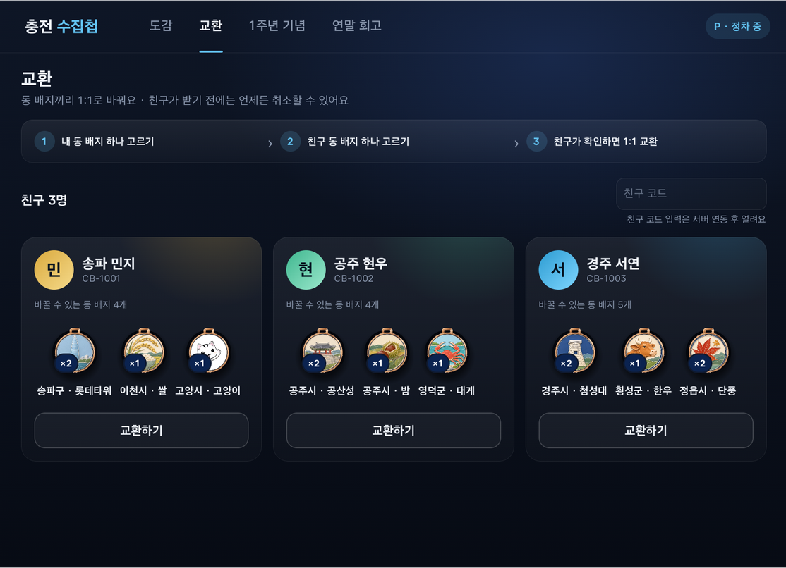
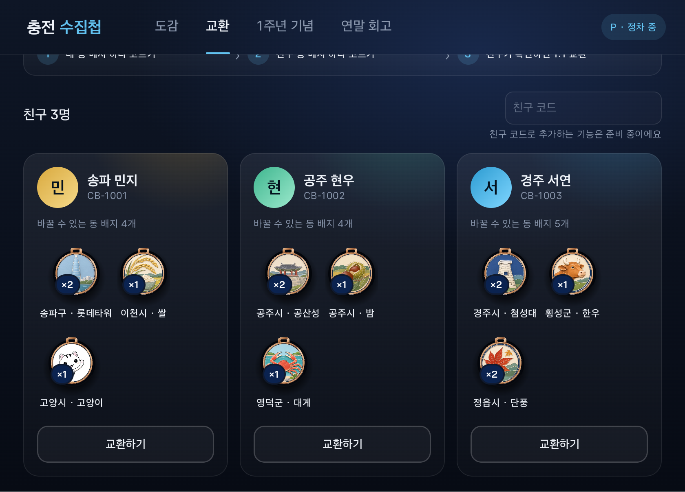
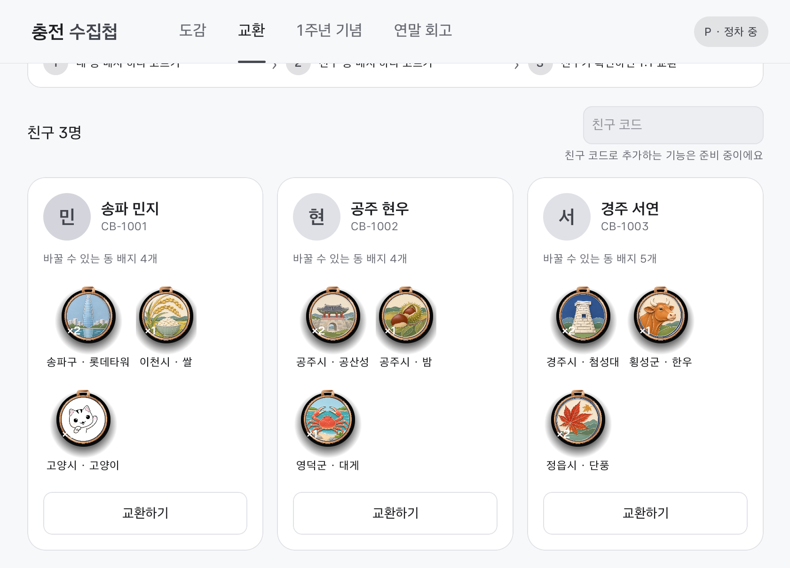

# Pleos 스타일 독립 검수 — 2026-11-15

**최초 검수 결과: 확인된 기능 회귀 없음, 수량 대비 회귀 1건 발견. 후속 PR #6에서 해당 수량 문제는 수정·머지되었습니다.** 아래 최초 검수 기록은 당시 소스 기준이며, 최신 해결 상태는 다음 절을 참고하세요.

## 후속 해결 확인 — 2026-11-15

- 별도 브랜치 `design/5-grey-hero`의 [PR #6](https://github.com/charge-collector-team/charge-collector/pull/6)은 MERGED 상태이며 최신 main에 포함되어 있습니다.
- `CountChip`은 불투명한 중립색 `#1D1E21` 배경 위에 흰 숫자를 표시합니다. 메달 크기에 따라 13~18sp로 조정하고, 왼쪽 아래 그림 바깥으로 옮겼습니다.
- `BadgeSlot`과 현위치 대표 메달의 수량 모두 공통 컴포넌트를 사용합니다. 밝은 고양이·쌀·밤 메달에서도 배경과 숫자의 대비가 유지됩니다.
- 최신 main `69cf2d7`의 코드와 아래 저장소 화면에서 해결 상태를 재확인했습니다. 같은 코드를 다시 수정하거나 중복 적용하지 않았습니다.
- 최신 main 소스로 `:core:test :app:assembleRelease :app:lintVitalRelease` 확인을 통과했습니다. 엔진 테스트 결과는 32개, 실패/오류 0입니다.
- 이번 확인에서 에뮬레이터가 연결 해제되어 새 실행 캡처는 확보하지 못했습니다. 아래 이미지는 최신 main에 이미 포함된 캡처입니다. 실차·실제 서버 검증을 뜻하지 않습니다.

## 최초 검수 기준과 독립성

- 원본: `491117e25522bf6cf6e9566650886809ca342750`.
- 스타일이 반영된 최신 main: `c2712458e64503fd95f9310120adf6a50826f02c` (PR #2 squash merge).
- 최초 검수 대상 디자인 브랜치: `b2b558a93fc7b14371db34d46f07180a1d0a4da0`. 앱 소스는 위 main과 동일합니다.
- 코드 검수와 시각·자료 검수를 별도 에이전트 2명이 읽기 전용으로 수행하고, 주 작업자가 수량 문제와 테스트 결과를 교차 확인했습니다.
- 원본 이후 변경된 소스 3개 전체 diff, 변경 파일 목록, 13개 전후 캡처와 상세 닫힘 화면, 최신 클립 전달 자료를 확인했습니다.
- 사용자 개인이 어느 코드를 수정했는지는 추정하지 않았습니다. 아래 판단은 실제 커밋 간 차이에 근거합니다.

## 최초 발견 기록 (현재 해결됨)

### [P2 · 해결] 작은 메달의 수량이 밝은 그림에 묻힘

[MainActivity.kt 662행](https://github.com/charge-collector-team/charge-collector/blob/c2712458e64503fd95f9310120adf6a50826f02c/app/src/main/java/kr/chargebadge/MainActivity.kt#L662)의 `BadgeSlot`이 수량을 항상 흰색으로 넘깁니다. 같은 파일 [597행](https://github.com/charge-collector-team/charge-collector/blob/c2712458e64503fd95f9310120adf6a50826f02c/app/src/main/java/kr/chargebadge/MainActivity.kt#L597)의 `CountChip`에서는 기존 불투명 배경이 제거됐습니다.

재현 조건: 친구 목록에 표시되는 작은 96dp 메달. 송파 민지 카드의 고양이·이천 쌀, 공주 현우 카드의 밤 메달에서 `×1`의 일부가 밝은 그림과 겹쳐 읽기 어렵습니다. 기존 남색 수량칩이 있던 원본과 비교하면 이번 스타일 변경의 회귀입니다. 수량 데이터가 바뀌는 문제가 아니라 읽기 문제입니다.

| 원본 | 스타일 변경 후 |
|---|---|
|  |  |

권장 검토: 수량을 그림 바깥에 놓거나, 작은 중립색 불투명 배경으로 대비를 확보합니다. 수정 범위는 `CountChip`·호출부로 제한하고 메달함·친구·교환 선택 화면의 수량과 선택선 겹침을 함께 확인합니다. **이번 검수에서는 수정하지 않았습니다.**

## 발견 후 보완된 문서

[P3] 교환 클립 생성 설명에서 Python 스크립트가 SVG/PNG를 모두 만든다고 했으나 실제로는 SVG만 저장했습니다. PNG는 `rsvg-convert` 별도 실행이 필요합니다. [클립 후속 PR #4](https://github.com/charge-collector-team/charge-collector/pull/4)의 커밋 `8e34ffb`에서 설명과 재생성 명령을 보완했습니다. 현재 PNG/SVG 자체는 정상입니다.

## 일관성과 코드 범위

- 원본 대비 앱 소스 변경은 `MainActivity.kt`, `Screens.kt`, `Images.kt` 3개입니다. 색·폰트 역할·진열면·선택선·메달 그림자와 테마 범위 조정입니다.
- 충전·교환·합성·주행 제한의 판정, 이벤트 처리, 상태 전이에서 새 변경을 찾지 못했습니다.
- `core`, 충전 서비스, 메달 원본 assets, 리소스, Manifest, Gradle 설정, 기존 release APK는 원본과 같습니다.
- 기존 분할 화면과 목록·상세·지도·트리 구성이 유지됩니다. 위 수량 문제 외에는 저장된 캡처에서 확실한 신규 잘림·글자 소실을 찾지 못했습니다.
- 밝은 중립색 조작부, 검은 진열면, 단색 버튼, 선택 외곽선이 화면 간 일관됩니다.
- 앱 소스 3개 SHA256은 `docs/design-review/validation.json`과 일치합니다.
- 최신 디자인 자료는 **3번 곡선 클립 선택·앱 미적용**이며 옛 키링/인장은 과거 제안으로 표시되어 있습니다. 클립 후속 PR #4는 main 대비 문서·시안 6파일만 변경합니다.

## 실행 검증

2026-11-15, 같은 앱 소스에서 확인했습니다.

| 확인 | 결과 |
|---|---|
| `:core:test --rerun-tasks` | 32개 재실행, 실패 0, 오류 0 |
| `:app:assembleRelease` | BUILD SUCCESSFUL (기존 산출물 활용) |
| `:app:lintVitalRelease` | 통과 (기존 산출물 활용) |
| `git diff --check` | 통과 |
| 13개 전후 PNG | 모두 정상, 각 전후 쌍 크기 동일 |
| 선택 클립 SVG/PNG | XML/이미지 정상 로드, 시각 확인 |

실행 환경은 Android Studio 번들 JBR, 로컬 Android SDK입니다. 새 테스트를 추가하지 않았습니다.

## 검증 한계와 다음 검토

실차, 실제 충전, 교환 서버, 주행 제한 화면의 실제 동작은 이번 독립 검수에서 실행하지 않았습니다. 저장된 에뮬레이터 화면과 코드 비교로 모든 기기·동작의 무결성을 보장할 수는 없습니다.

- [x] 수량 표시 대비 수정 필요성·표시 방식 결정 — PR #6 적용
- [x] 별도 코드 수정 브랜치에서 반영하고 화면 캡처 검토 — PR #6 및 최신 저장소 캡처 확인
- [ ] 실제 차량에서 주행 제한과 장시간 실행 확인
- [ ] 실제 교환 기능/서버 연동 검증은 별도 환경에서 확인

이 검수 브랜치는 자동 머지하지 않습니다. 교환 보유 출처 설계는 기존 [기술 검토 PR #3](https://github.com/charge-collector-team/charge-collector/pull/3)의 별도 범위입니다.
